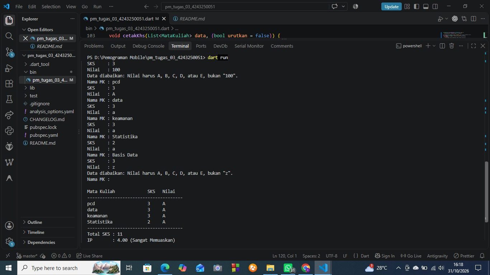

# Tugas Rutin 3: Kalkulator IP Semester (Console)

## Identitas
- Nama : Dea Anggraini
- NIM  : 4243250051
- Kelas: PSIK 24 C
- Mata Kuliah: Pemrograman Mobile, Pertemuan 3

## Tangkapan Layar Sesi

## Penjelasan
Higher-order function saya gunakan di tiga tempat. Pertama, `hitungIp` memakai `fold` untuk menjumlahkan SKS × bobot dan total SKS dari seluruh data. Kedua, `perluDiperbaiki` memakai `where` dengan fungsi anonim untuk menyaring mata kuliah yang bobotnya kurang dari 2. Ketiga, `cetakKhs` memakai `sort` dengan fungsi pembanding agar daftar terurut dari nilai tertinggi. Error handling dilakukan dengan memisahkan tugas: `validasiSks` dan `validasiNilai` melempar `FormatException` bila input tidak valid, sedangkan `main` menangkapnya dengan `try`/`on FormatException catch`, mencetak pesan "Data diabaikan", lalu melanjutkan perulangan. Dengan begitu program tidak berhenti walau pengguna salah mengetik, dan setiap fungsi tetap pendek serta hanya mengerjakan satu hal. Pemisahan ini juga memudahkan pengujian setiap fungsi secara terpisah.

## Pernyataan Penggunaan AI
Saya menggunakan AI sebagai penyusun draf kode awal. Kode saya jalankan, uji, dan pelajari sendiri.